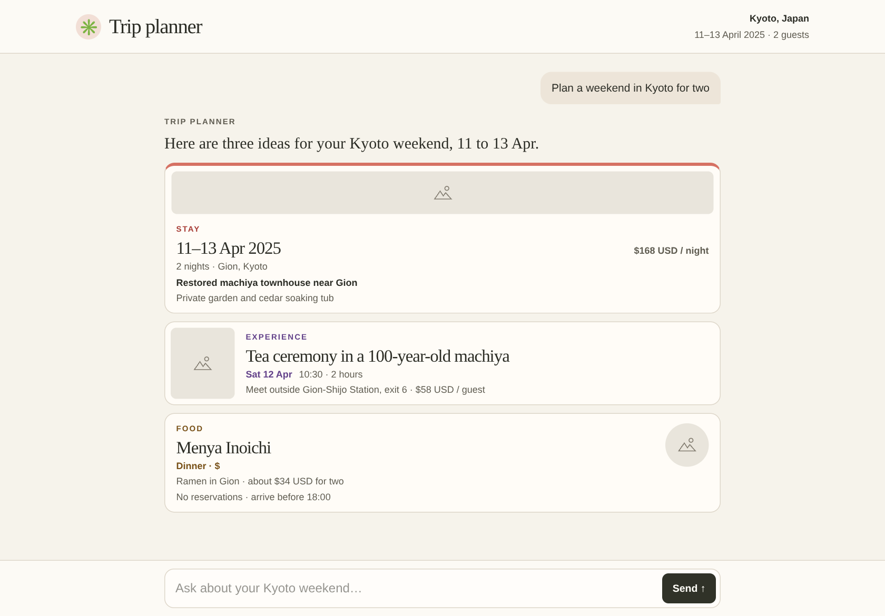

# Kyoto weekend chat

A personal trip-planning prototype for two guests in Kyoto, 11–13 April 2025. It displays a fixed mock reply with three cards in order: Stay, Experience, and Food. The data comes from rows S1, E1, and F1 of the Kyoto Weekend Prototype Content Pack. The layouts use photo placeholders.



## Run locally

With Node.js 20.9 or newer, run these commands from the project directory:

```sh
npm ci
npm run dev
```

Open <http://localhost:3000/> and send **Plan a weekend in Kyoto for two**. The composer locks while the dots animate. The three cards then appear and the composer unlocks.

## Test retry

1. Open <http://localhost:3000/?fail=once> in a fresh page.
2. Send **Plan a weekend in Kyoto for two**.
3. After the thinking animation, the assistant shows an error with **Try again**.
4. Select **Try again**. The same response bubble fills with the three cards and the stay dates remain 11–13 April 2025. The simulated failure is used up until the page is reloaded.

## Card components

The Next.js app uses Tailwind CSS and renders each card through a separate component: [Stay](app/components/StayCard.jsx), [Experience](app/components/ExperienceCard.jsx), and [Food](app/components/FoodCard.jsx).
